<div align="center">


# Change Ledger

**Worked last week, broken today? See exactly what changed in Windows between any two days.**

**English** · [Русский](README.ru.md)

[](https://github.com/lojekq/ChangeLedger/releases/latest)
[](https://github.com/lojekq/ChangeLedger/releases)
[](https://github.com/lojekq/ChangeLedger/actions/workflows/ci.yml)

[](LICENSE)

<picture>
  <source media="(prefers-color-scheme: dark)" srcset="docs/changes-dark-en.png">
  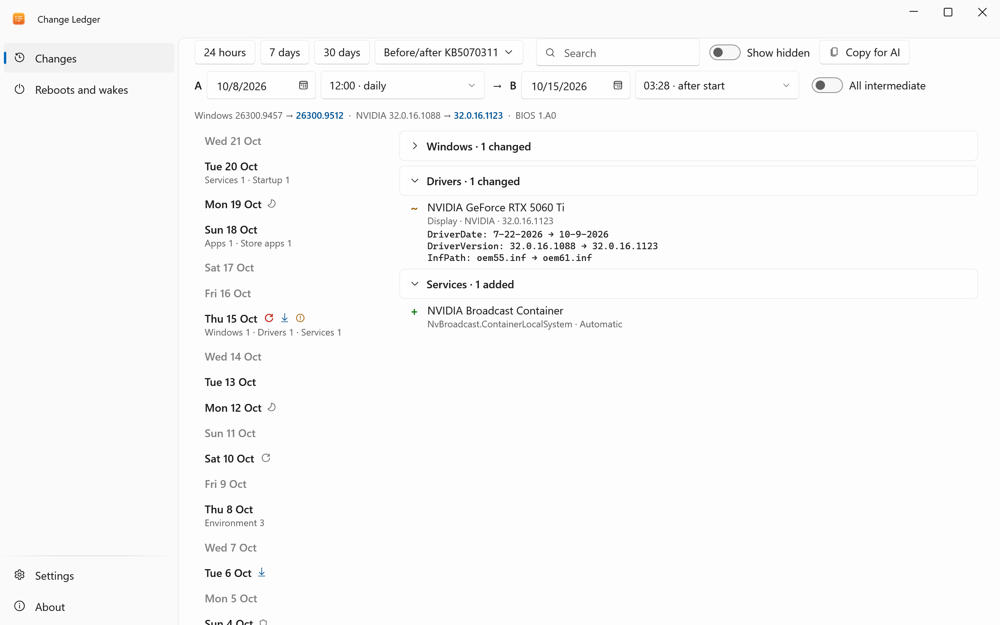
</picture>
</div>

## Why

A game started crashing, the PC wakes up at night, a tool stopped finding Python. Something changed, but what and when?
Change Ledger takes a small read-only snapshot of what usually breaks Windows once a day and shows the difference between any two dates.
A second page explains every restart and wake-up from the Windows logs: who, when and why.

## Features

- **Daily snapshots** — apps, drivers, services, scheduled tasks, startup items, firewall rules, environment variables with PATH, hosts, proxy and DNS, Store apps, wake devices; no admin rights, everything stays on your PC.
- **Any two days** — a timeline and a diff by category, "was → now" for every property; the net difference or every step in between.
- **Before and after a Windows update** — in one click.
- **Why it restarted or woke up** — planned restart, BSOD, power loss, a held power button; a task timer or a device, with what to turn off; a notification after an unexpected restart.
- **Crashes and Defender on the same timeline** — app crashes, GPU driver resets and changes of Defender exclusions next to what changed.
- **Private and read-only** — secrets are masked, no network, nothing in Windows is changed; noisy lines go away with **Hide such**.
- **Copy for AI** — the diff as Markdown for Claude or a local model.

## See it in action

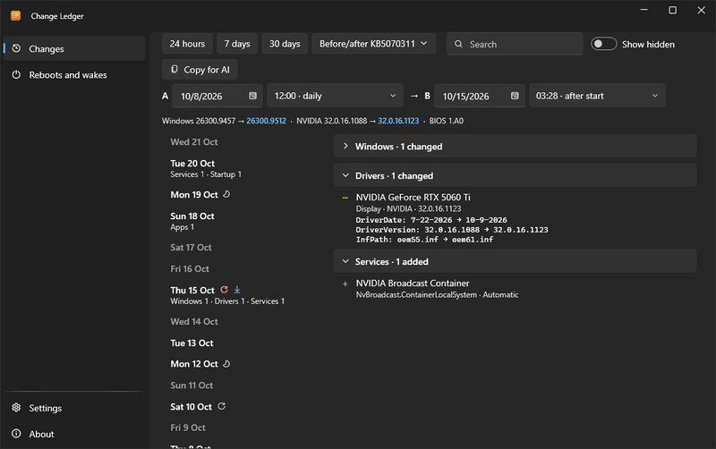

## How it works

A Task Scheduler task of your own user runs the same exe once a day without a window (`ChangeLedger.exe --snapshot`).
It reads the registry and the Task Scheduler, keeps the result as compressed JSON and writes a new file only if something changed.
Restarts, wake-ups, crashes and Defender exclusion changes are read from the Windows logs; every snapshot also copies them to `events.jsonl`, so the history outlives the rotation of the logs.

Why not Reliability Monitor or Autoruns? Reliability Monitor does not see drivers, services or PATH.
Autoruns shows what starts now, but not what it was yesterday.

## Screenshots

| | Light | Dark |
|---|---|---|
| Apps and startup | 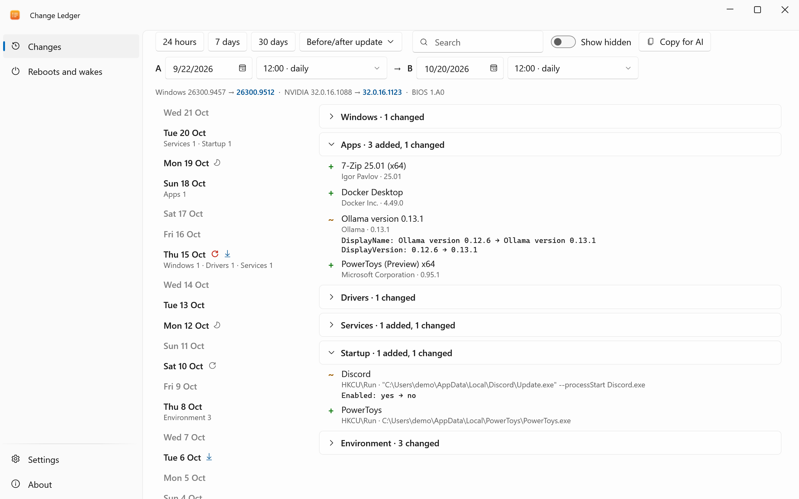 | 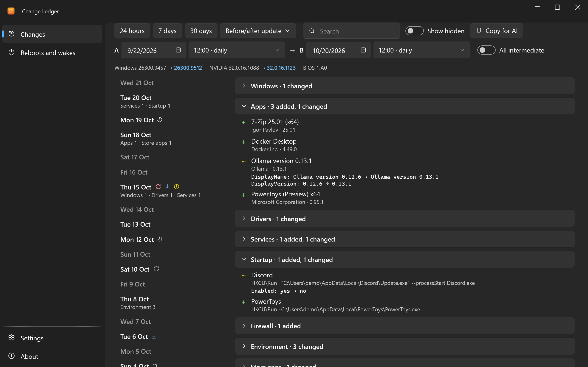 |
| PATH and variables | 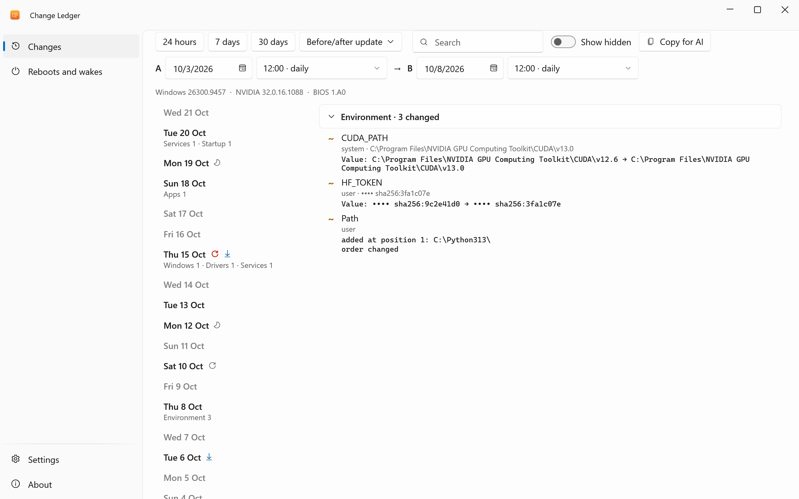 | 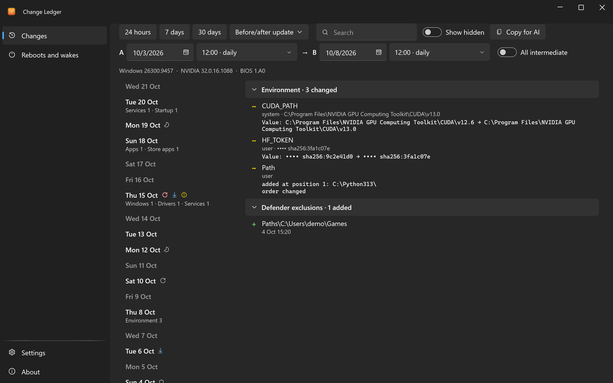 |
| All intermediate changes | 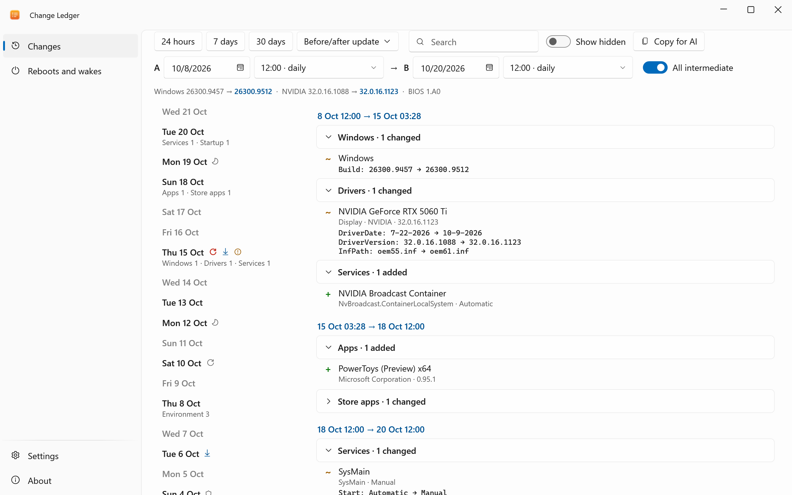 | 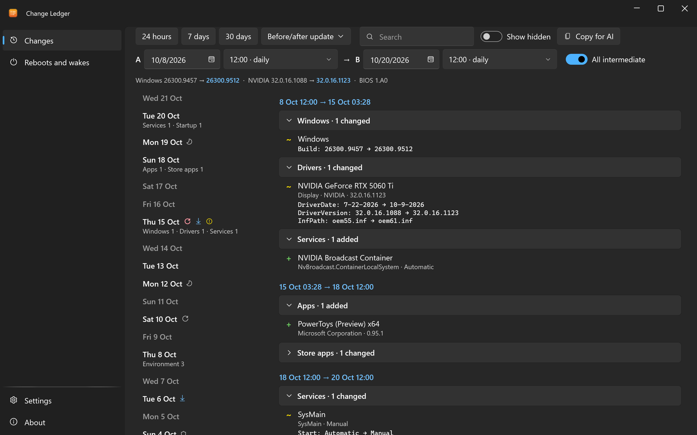 |
| Reboots and wakes | 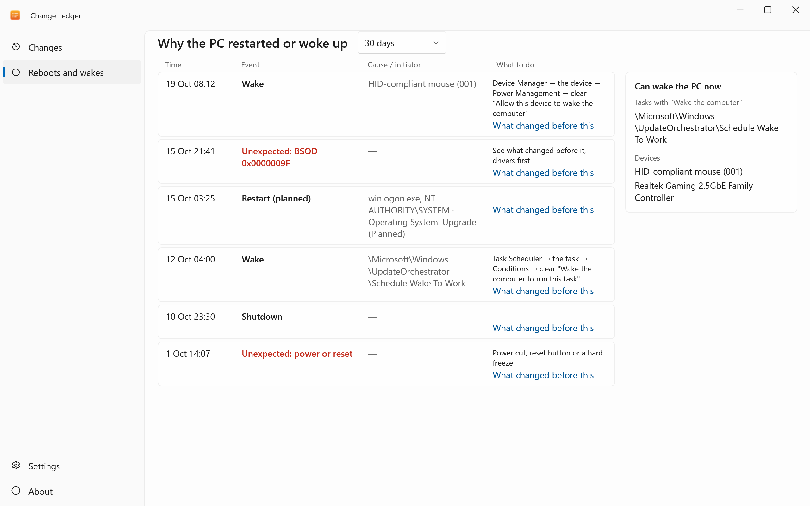 | 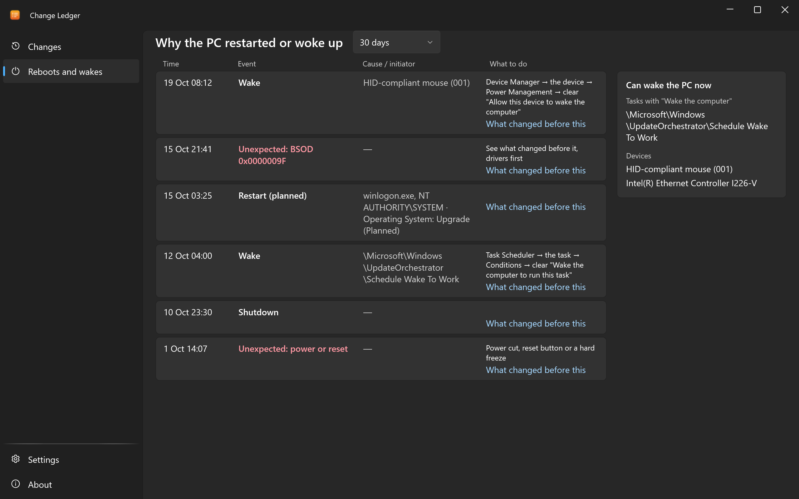 |
| Settings | 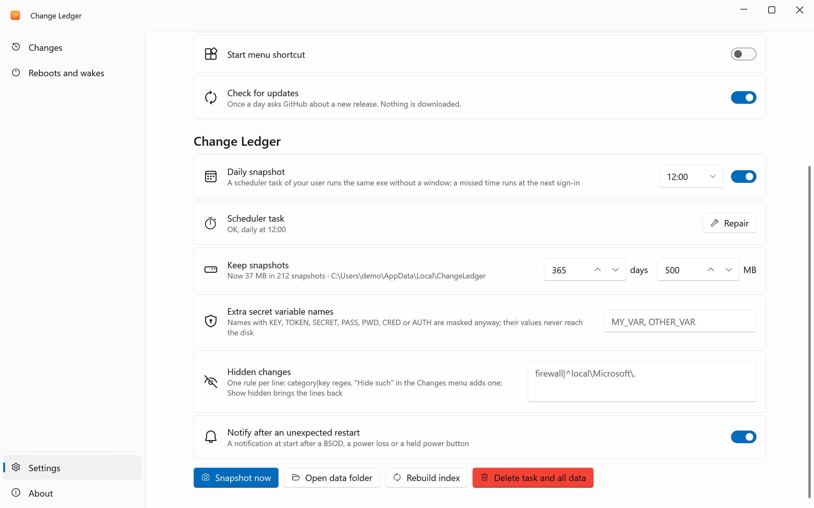 | 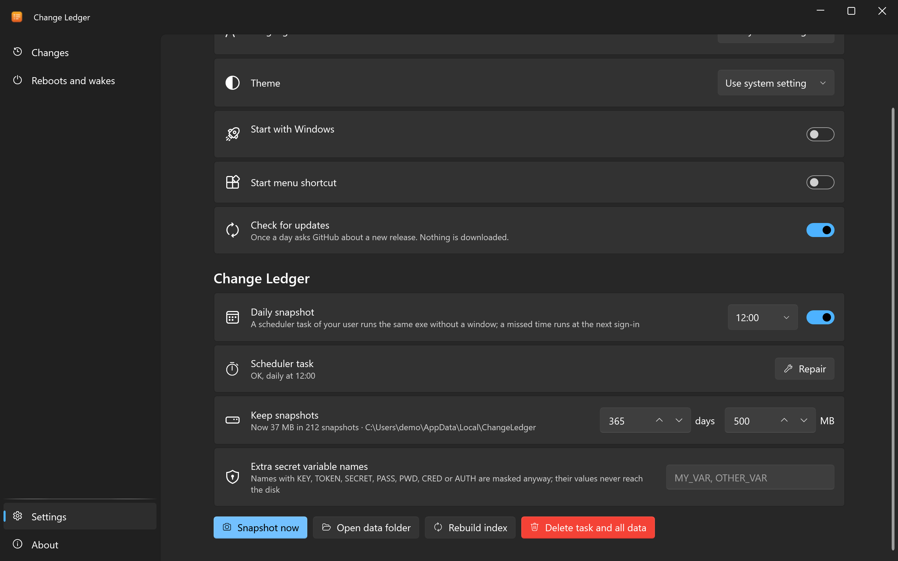 |

## Download

1. **[Download ChangeLedger.exe](https://github.com/lojekq/ChangeLedger/releases/latest/download/ChangeLedger.exe)** (latest release). One file, no admin rights.
2. Smaller build: [`ChangeLedger-fd.zip`](https://github.com/lojekq/ChangeLedger/releases/latest/download/ChangeLedger-fd.zip) (needs [.NET Desktop Runtime 10](https://dotnet.microsoft.com/download/dotnet/10.0)).
3. Optional check: `gh attestation verify <file> -R lojekq/ChangeLedger` or compare with `SHA256SUMS.txt`.

Requirements: Windows 11 x64. Windows 10 22H2 should work but is not tested.

## First run

Run the downloaded exe from anywhere. Windows may show a SmartScreen warning first (see FAQ).
The app offers to install itself: **Install** copies it to `%LOCALAPPDATA%\Programs\ChangeLedger\`, adds a Start menu shortcut, autostart, an entry in Settings → Apps and the daily scheduler task; no admin rights.
**Run without installing** keeps it portable: then only **Repair** in Settings creates the task. To update, run a newer exe the same way: it replaces the installed one and restarts it.
The first snapshot is taken 2 minutes after the start; there is something to compare it with from the next day, and every restart gets an "after the update" snapshot.

## Settings

| Setting | Default | What it does |
|---|---|---|
| Daily snapshot | on, 12:00 | The task runs a snapshot every day; if the PC was off, it runs at the next sign-in |
| Keep snapshots | 365 days, 500 MB | Older and extra snapshots are deleted; the two newest never are |
| Extra secret variable names | none | More environment variables to mask; names with KEY, TOKEN, SECRET, PASS, PWD, CRED or AUTH are always masked |
| Hidden changes | none | One rule per line, `category\|key regex`; **Hide such** in the row menu adds one, **Show hidden** brings the lines back |
| Notify after an unexpected restart | on | A notification at start after a BSOD, a power loss or a held power button |
| Language, theme | Windows | English or Russian (after a restart), light or dark |
| Start with Windows | on after install | Starts minimized to the tray; 2 minutes after the start it takes a snapshot if the last one is over an hour old |
| Start menu shortcut | on after install | A shortcut in the Start menu |
| Installation | — | Install, or Uninstall when installed |
| Check for updates | on | Once a day asks GitHub about a new release |

Settings and logs live in `%APPDATA%\ChangeLedger`, snapshots in `%LOCALAPPDATA%\ChangeLedger` (about 80 KB for a day with changes; days without changes take nothing).
Settings also show the task status with **Repair**, **Snapshot now**, **Rebuild index** and **Delete task and all data**.

## FAQ

<details><summary>Windows protected your PC / SmartScreen warning</summary>

The exe is not code-signed yet, so Windows does not know the publisher. Click **More info → Run anyway**.
Every file is built by GitHub Actions from this repository; you can check it with `gh attestation verify` or `SHA256SUMS.txt`.
Smart App Control, if it is on, blocks unsigned files with no way to allow one; the only option is to turn it off.
</details>

<details><summary>My antivirus flags it</summary>

It is a false positive. An unsigned exe that creates a scheduled task and reads startup keys and environment variables looks like malware to a heuristic.
The task is called `ChangeLedger Snapshot (<your SID>)` and says what it does; the app has no packer and no obfuscation, and it installs only into your user folder.
Please report it to your antivirus vendor and open an issue with the detection name and the SHA256 of the file.
</details>

<details><summary>I see changes I did not make</summary>

Windows and updaters change things on their own: Edge and Office tasks, services that switch their start type.
Known noise is hidden; right-click a line → **Hide such** hides more, **Show hidden** brings everything back. If something keeps showing up for nothing, open an issue with the line from **Copy**.
</details>

<details><summary>Why no snapshot when I run it as administrator?</summary>

As administrator Windows shows scheduled tasks that a normal user never sees, so snapshots would stop being comparable.
Start Change Ledger the usual way; it never needs admin rights.
</details>

<details><summary>How do I uninstall?</summary>

Settings → **Uninstall**, or Windows Settings → Apps → Change Ledger → Uninstall. The scheduler task goes too; you choose whether settings, logs and snapshots go as well.
Without installing: About → **Remove data and autostart** (it also deletes the scheduler task and all snapshots), then delete the exe.
</details>

## Privacy

No telemetry. The only network request is the update check: `GET https://api.github.com/repos/lojekq/ChangeLedger/releases/latest` once a day; turn it off in Settings.
Snapshots never leave your PC. Values of secret-looking variables and `--token=…` style arguments are replaced with a salted hash before anything reaches the disk.
**Copy for AI** only puts that masked text on the clipboard. Logs contain no command lines or variable values.

## Build from source

```powershell
winget install Microsoft.DotNet.SDK.10
git clone https://github.com/lojekq/ChangeLedger
cd ChangeLedger
dotnet run --project src/ChangeLedger
dotnet test
```

`--demo` runs the app on made-up snapshots without reading your PC.

## License

MIT © 2026 lojekq
