<div align="center">


# Change Ledger

**Вчера работало, сегодня нет? Посмотри, что именно изменилось в Windows между двумя любыми днями.**

[English](README.md) · **Русский**

[](https://github.com/lojekq/ChangeLedger/releases/latest)
[](https://github.com/lojekq/ChangeLedger/releases)
[](https://github.com/lojekq/ChangeLedger/actions/workflows/ci.yml)

[](LICENSE)

<picture>
  <source media="(prefers-color-scheme: dark)" srcset="docs/changes-dark-ru.png">
  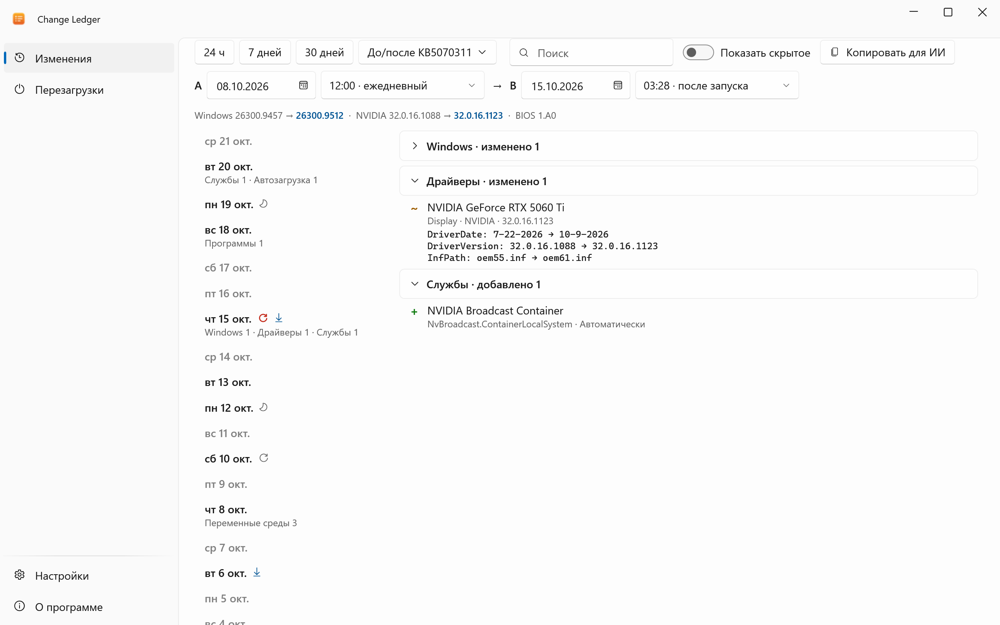
</picture>
</div>

## Зачем

Игра начала падать, ПК просыпается ночью, инструмент перестал находить Python. Что-то изменилось, но что и когда?
Change Ledger раз в день делает небольшой снимок того, что обычно ломает Windows, только чтением, и показывает разницу между двумя любыми датами.
Вторая страница объясняет каждую перезагрузку и пробуждение по журналам Windows: кто, когда и почему.

## Возможности

- **Ежедневные снимки** — программы, драйверы, службы, задачи планировщика, автозагрузка, правила брандмауэра, переменные среды с PATH, hosts, прокси и DNS, приложения Store, устройства пробуждения; без прав администратора, всё остаётся на ПК.
- **Два любых дня** — таймлайн и дифф по категориям, «было → стало» для каждого свойства; итоговая разница или каждый шаг между снимками.
- **До и после обновления Windows** — в один клик.
- **Почему перезагрузился или проснулся** — плановая перезагрузка, BSOD, потеря питания, удержание кнопки; таймер задачи или устройство, с подсказкой, что отключить; уведомление после неожиданной перезагрузки.
- **Сбои и Defender на том же таймлайне** — падения программ, сбросы драйвера видеокарты и изменения исключений Defender рядом с тем, что изменилось.
- **Приватно и только чтение** — секреты маскируются, сеть не нужна, в Windows ничего не меняется; шумные строки убираются кнопкой **Скрывать такие**.
- **Копировать для ИИ** — дифф в Markdown для Claude или локальной модели.

## Как это выглядит

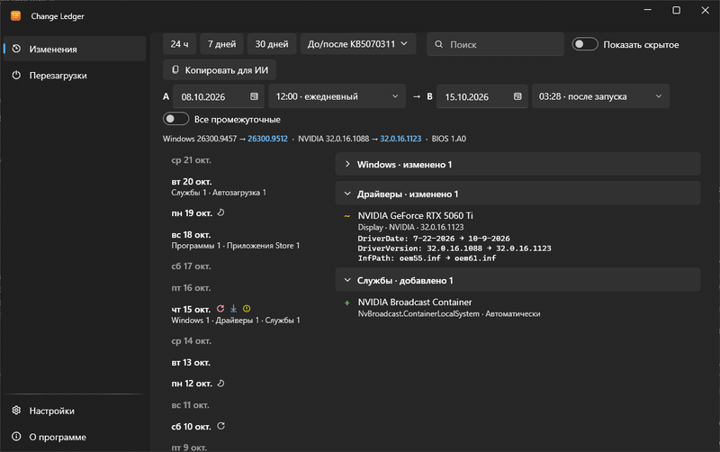

## Как это работает

Задача планировщика вашего пользователя раз в день запускает тот же exe без окна (`ChangeLedger.exe --snapshot`).
Он читает реестр и планировщик, хранит результат как сжатый JSON и пишет новый файл, только если что-то изменилось.
Перезагрузки, пробуждения, сбои и изменения исключений Defender берутся из журналов Windows; каждый снимок заодно копирует их в `events.jsonl`, так что история переживает ротацию журналов.

Почему не «Монитор стабильности» и не Autoruns? Монитор стабильности не видит драйверы, службы и PATH.
Autoruns показывает, что запускается сейчас, но не то, что было вчера.

## Скриншоты

| | Светлая | Тёмная |
|---|---|---|
| Программы и автозагрузка | 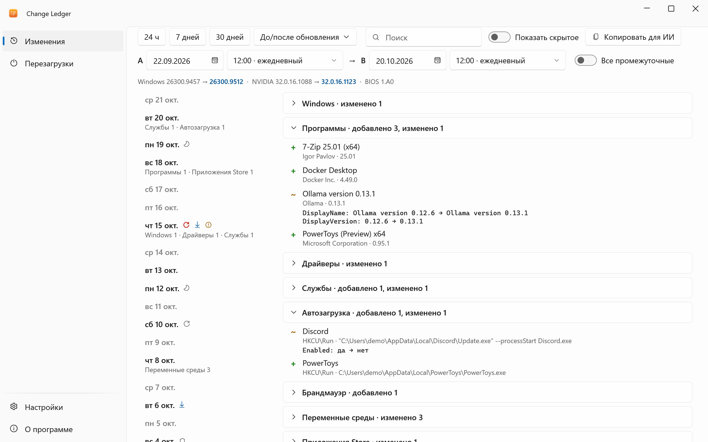 | 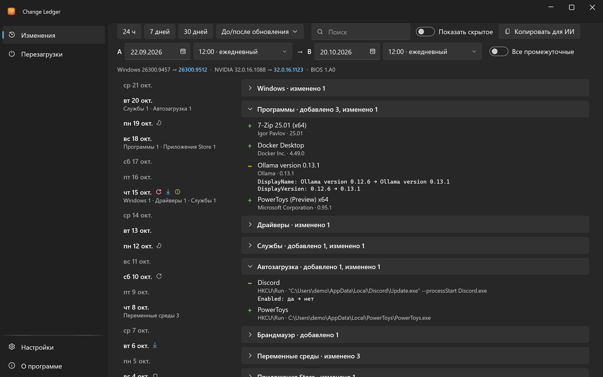 |
| PATH и переменные | 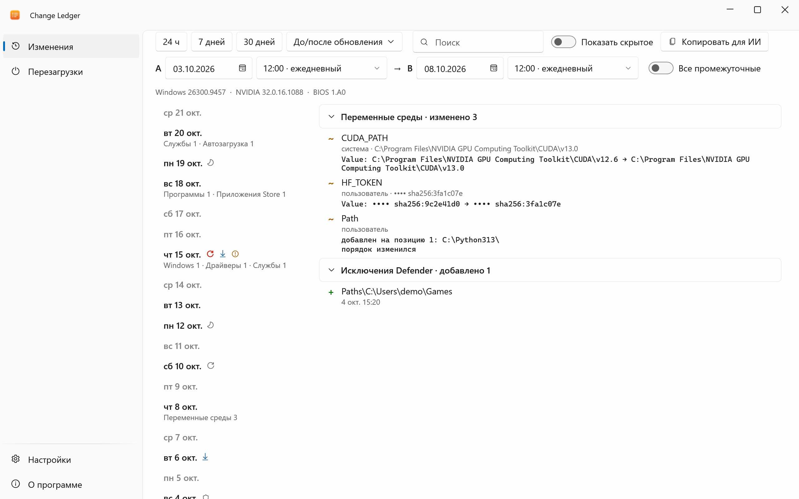 | 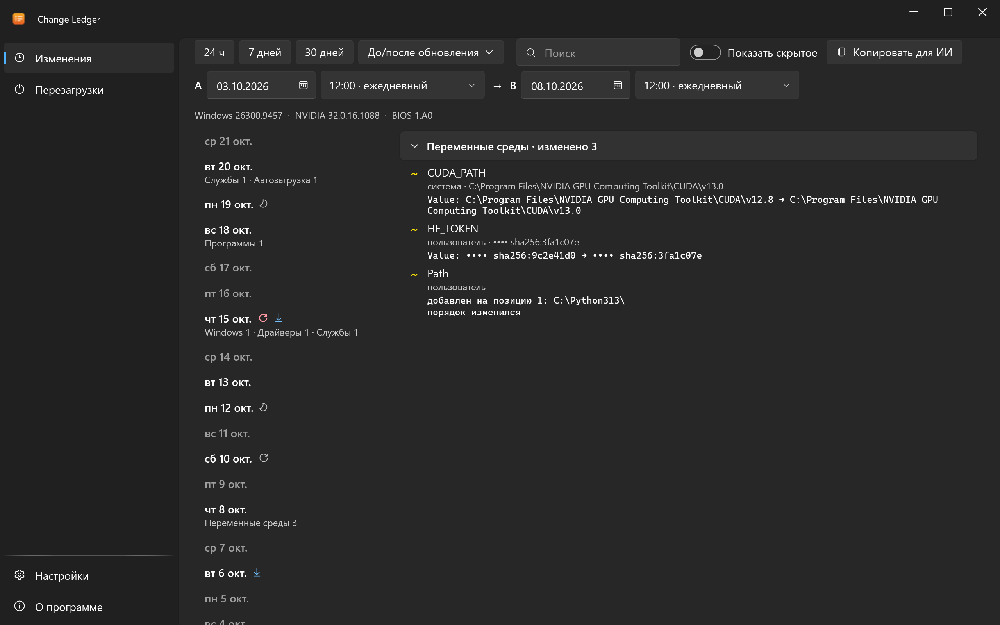 |
| Все промежуточные изменения | 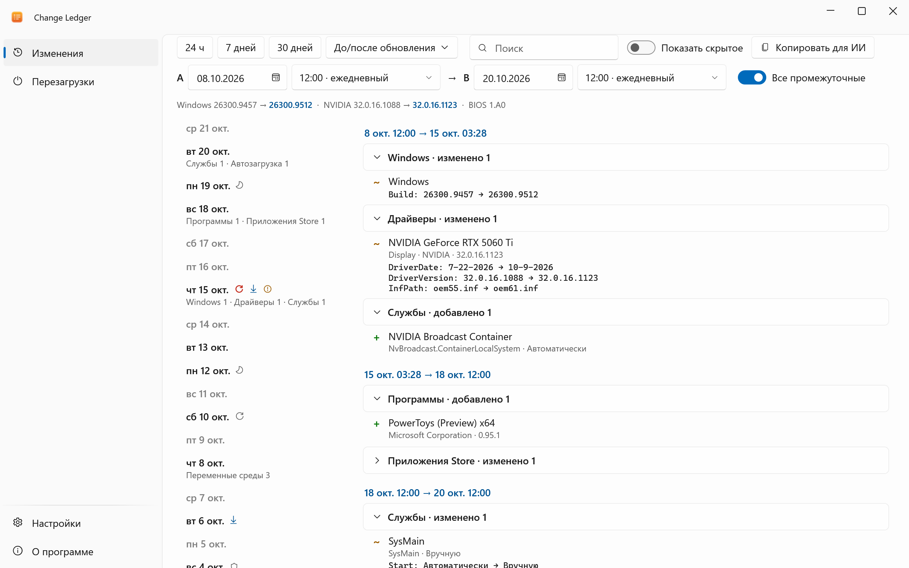 | 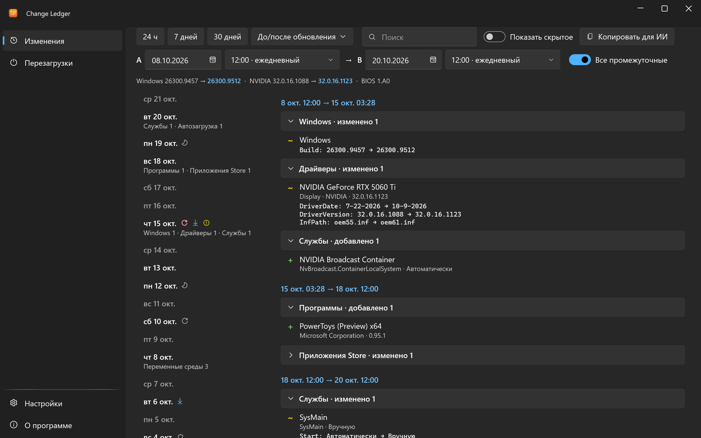 |
| Перезагрузки и пробуждения | 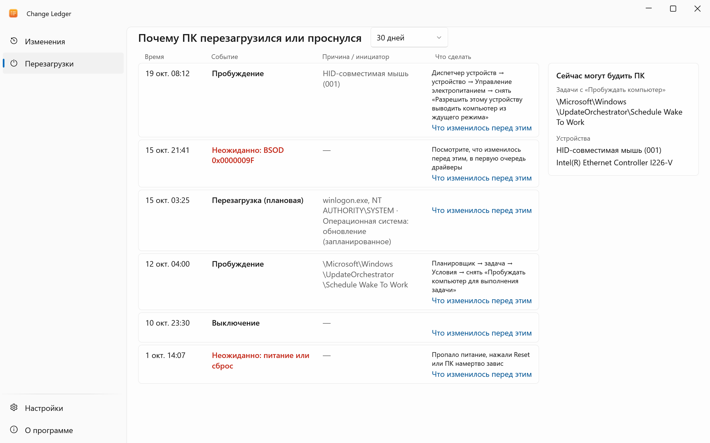 | 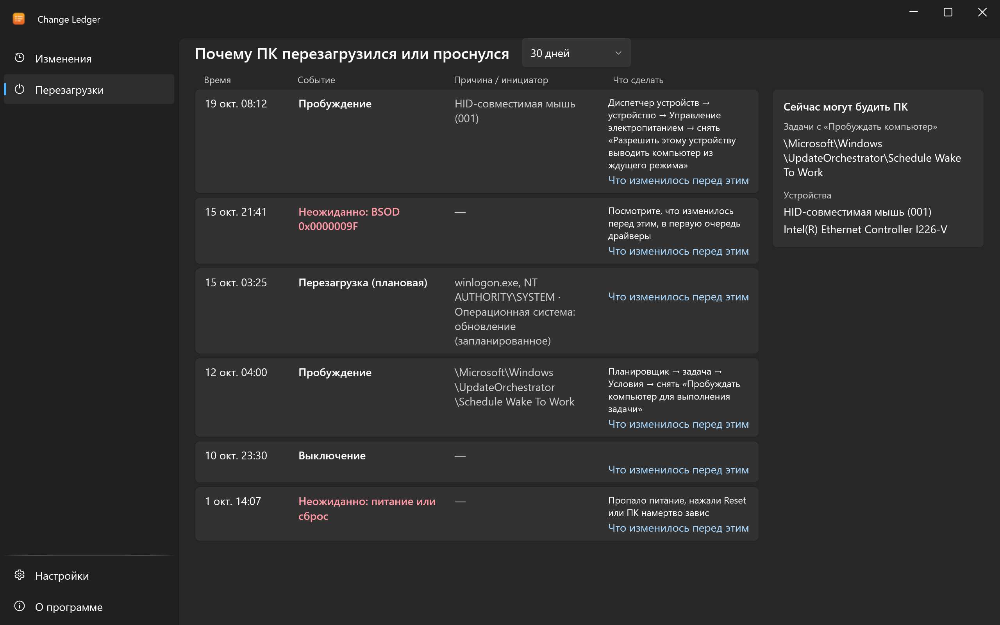 |
| Настройки | 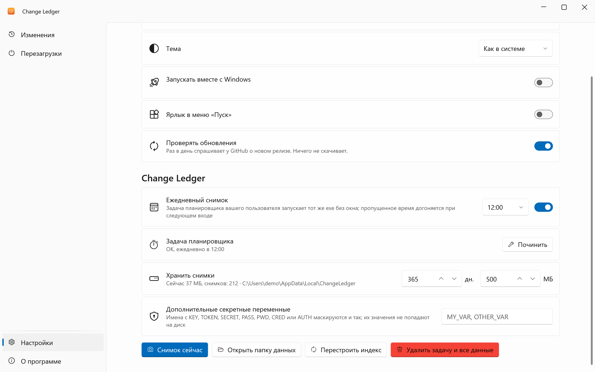 | 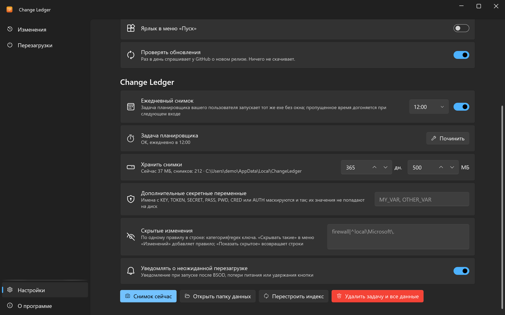 |

## Скачать

1. **[Скачать ChangeLedger.exe](https://github.com/lojekq/ChangeLedger/releases/latest/download/ChangeLedger.exe)** (последний релиз). Один файл, без прав администратора.
2. Сборка поменьше: [`ChangeLedger-fd.zip`](https://github.com/lojekq/ChangeLedger/releases/latest/download/ChangeLedger-fd.zip) (нужен [.NET Desktop Runtime 10](https://dotnet.microsoft.com/download/dotnet/10.0)).
3. Проверка по желанию: `gh attestation verify <файл> -R lojekq/ChangeLedger` или сверка с `SHA256SUMS.txt`.

Требования: Windows 11 x64. Windows 10 22H2 должна работать, но не тестируется.

## Первый запуск

Запустите скачанный exe откуда угодно. Сначала Windows может показать предупреждение SmartScreen (см. «Вопросы»).
Программа предложит установиться: **Установить** копирует её в `%LOCALAPPDATA%\Programs\ChangeLedger\`, добавляет ярлык в «Пуске», автозапуск, запись в «Параметры → Приложения» и ежедневную задачу планировщика; права администратора не нужны.
**Без установки** оставляет её переносной: тогда задачу создаёт только кнопка **Починить** в настройках. Для обновления запустите новый exe так же: он заменит установленный и перезапустит его.
Первый снимок будет через 2 минуты после запуска; сравнивать будет с чем со следующего дня, а после каждой перезагрузки появится снимок «после обновления».

## Настройки

| Настройка | По умолчанию | Что делает |
|---|---|---|
| Ежедневный снимок | вкл., 12:00 | Задача делает снимок каждый день; если ПК был выключен, снимок будет при следующем входе |
| Хранить снимки | 365 дней, 500 МБ | Старые и лишние снимки удаляются; два самых новых не удаляются никогда |
| Дополнительные секретные переменные | нет | Ещё переменные среды для маскирования; имена с KEY, TOKEN, SECRET, PASS, PWD, CRED или AUTH маскируются всегда |
| Скрытые изменения | нет | По одному правилу в строке, `категория\|regex ключа`; **Скрывать такие** в меню строки добавляет правило, **Показать скрытое** возвращает строки |
| Уведомлять о неожиданной перезагрузке | вкл. | Уведомление при запуске после BSOD, потери питания или удержания кнопки |
| Язык, тема | как в Windows | Английский или русский (после перезапуска), светлая или тёмная |
| Запускать вместе с Windows | вкл. после установки | Стартует свёрнутой в трей; через 2 минуты после запуска делает снимок, если прошлый старше часа |
| Ярлык в меню «Пуск» | вкл. после установки | Ярлык в меню «Пуск» |
| Установка | — | Установить или, если программа установлена, удалить |
| Проверять обновления | вкл. | Раз в день спрашивает у GitHub о новом релизе |

Настройки и логи лежат в `%APPDATA%\ChangeLedger`, снимки в `%LOCALAPPDATA%\ChangeLedger` (около 80 КБ на день с изменениями; дни без изменений места не занимают).
В настройках также статус задачи с кнопкой **Починить**, **Снимок сейчас**, **Перестроить индекс** и **Удалить задачу и все данные**.

## Вопросы

<details><summary>Система Windows защитила ваш компьютер / SmartScreen</summary>

У exe пока нет цифровой подписи, поэтому Windows не знает издателя. Нажмите **Подробнее → Выполнить в любом случае**.
Каждый файл собран GitHub Actions из этого репозитория; проверить можно через `gh attestation verify` или `SHA256SUMS.txt`.
Если включён Smart App Control, он блокирует неподписанные файлы без возможности разрешить; единственный вариант — выключить его.
</details>

<details><summary>Антивирус ругается</summary>

Это ложное срабатывание. Неподписанный exe, который создаёт задачу планировщика и читает ключи автозагрузки и переменные среды, эвристике кажется вредоносным.
Задача называется `ChangeLedger Snapshot (<ваш SID>)` и в описании говорит, что делает; у программы нет упаковщика и обфускации, ставится она только в папку пользователя.
Сообщите о срабатывании производителю антивируса и откройте issue с названием детекта и SHA256 файла.
</details>

<details><summary>Вижу изменения, которых я не делал</summary>

Windows и программы обновления меняют систему сами: задачи Edge и Office, службы, которые переключают тип запуска.
Известный шум скрыт; правый клик по строке → **Скрывать такие** скрывает ещё, **Показать скрытое** возвращает всё. Если что-то постоянно появляется без причины, откройте issue со строкой из **Копировать**.
</details>

<details><summary>Почему нет снимка, если запустить от администратора?</summary>

Под администратором Windows показывает задачи планировщика, которых обычный пользователь не видит, и снимки перестали бы быть сравнимыми.
Запускайте Change Ledger обычным способом, права администратора ему не нужны.
</details>

<details><summary>Как удалить?</summary>

Настройки → **Удалить**, или «Параметры Windows → Приложения → Change Ledger → Удалить». Задача планировщика удаляется вместе с программой; настройки, логи и снимки — по вашему выбору.
Без установки: «О программе» → **Удалить данные и автозапуск** (заодно удаляются задача планировщика и все снимки), затем удалите exe.
</details>

## Приватность

Телеметрии нет. Единственный сетевой запрос — проверка обновлений: `GET https://api.github.com/repos/lojekq/ChangeLedger/releases/latest` раз в день, отключается в настройках.
Снимки не покидают ПК. Значения переменных, похожих на секреты, и аргументы вида `--token=…` заменяются хэшем с солью до записи на диск.
**Копировать для ИИ** только кладёт этот замаскированный текст в буфер обмена. В логах нет командных строк и значений переменных.

## Сборка из исходников

```powershell
winget install Microsoft.DotNet.SDK.10
git clone https://github.com/lojekq/ChangeLedger
cd ChangeLedger
dotnet run --project src/ChangeLedger
dotnet test
```

`--demo` запускает программу на выдуманных снимках, не читая ваш ПК.

## Лицензия

MIT © 2026 lojekq
